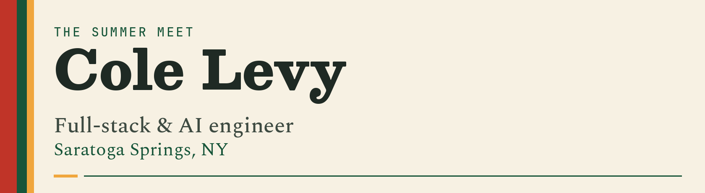
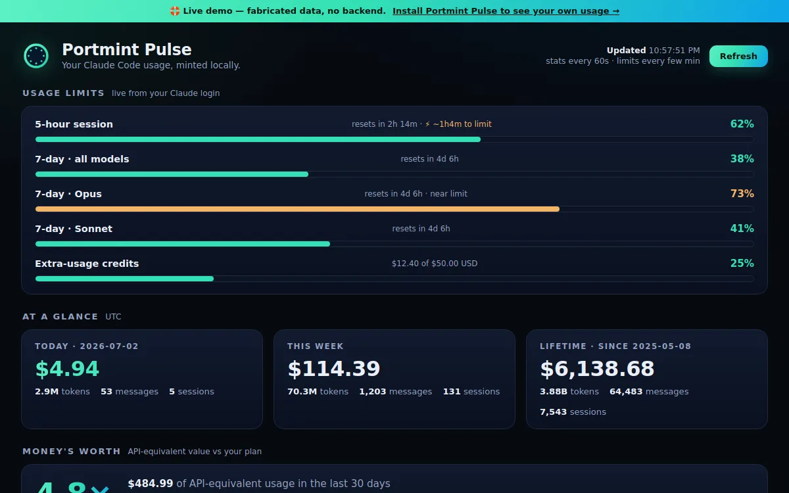

<picture>
  <source media="(prefers-color-scheme: dark)" srcset="./assets/masthead-dark.png">
  
</picture>

Full-stack and AI engineer in Saratoga Springs. I ship products I run, and software for businesses that have to look serious on day one.

[Portfolio](https://colelevy.dev) · [LinkedIn](https://www.linkedin.com/in/colelevy) · [colelevy08@gmail.com](mailto:colelevy08@gmail.com) · [dev.to](https://dev.to/colelevy)

## handAIcapper

Thoroughbred handicapping for the Saratoga meet and 40+ other North American tracks. The app reads today's card, calls an order of finish, sizes with Kelly, and scores those calls on the official results.

[handaicapper.com](https://handaicapper.com) · [Graded record](https://handaicapper.com/record)

A Portmint product, built as a trackside PWA.

## Portmint Pulse

Local dashboard for Claude Code. It reads live rate-limit windows and charts token and cost use by model and project. Python standard library, on the machine, no telemetry.

<a href="https://colelevy.dev"></a>

[See it on the portfolio](https://colelevy.dev).

## FableKalshi

Private trading system for Kalshi's 15-minute and hourly crypto binaries. The public part is the math an order has to clear:

**[kalshi-edge](https://github.com/colelevy08/kalshi-edge)** — fee-aware expected value and fractional-Kelly sizing for Kalshi binary contracts. Zero dependencies, MIT, tested.

```bash
pip install git+https://github.com/colelevy08/kalshi-edge
```

## Also shipping

**[Portmint](https://portmint.com)** — Branded AI assistants for a business's own website. Self-serve: point it at a site, and it answers customers, books, and captures the lead. handAIcapper runs on this platform.

**[Standard Fare](https://www.standardfaresaratoga.com/)** — American restaurant in Saratoga Springs. I helped open the room in 2025 and assistant-manage the floor.

**[Bocage](https://www.bocagechampagnebar.com/)** — Champagne bar in Saratoga Springs.

**[PolyBot](https://github.com/colelevy08/PolyBot)** — Polymarket copy-trading bot. It scores wallets, checks the live book for edge, and sizes with fractional Kelly.

**[GrooveStack](https://github.com/colelevy08/groovestack)** — Social marketplace for vinyl collectors.

## Stack

React, TypeScript, Vite, and Tailwind on [the portfolio](https://github.com/colelevy08/Portfolio2026). Python for [kalshi-edge](https://github.com/colelevy08/kalshi-edge) and [PolyBot](https://github.com/colelevy08/PolyBot). Node for [GrooveStack](https://github.com/colelevy08/groovestack). handAIcapper ships as a Vite PWA.

## About

Communication at SUNY Geneseo, with semesters at La Sorbonne and Sciences Po, then Flatiron School in 2023. I write the spec and read every diff. Claude Code stays in the loop.

Health · History · Horses.

[colelevy.dev](https://colelevy.dev)
